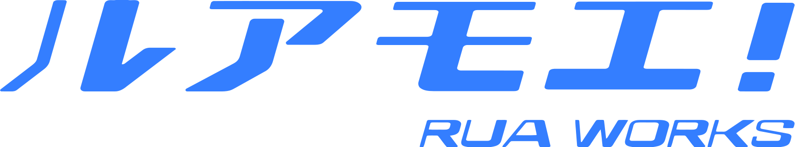

<em>神は乗り越えられる試練しか与えない。</em>

<h1 align="center">Hi 👋, I'm Hikaru</h1>

<strong>Full-stack Engineer</strong> ・ AI Infrastructure / Web3 / Security Research ・ Tokyo, Japan

<em>I build the whole stack — from Solidity contracts and sub-millisecond matching engines to kernel modules and pixel-perfect UI.</em>

  <a href="mailto:hikaru@rua.moe">hikaru@rua.moe</a> ・
  <a href="https://rua.moe">rua.moe</a> ・
  <a href="https://linkedin.com/in/hikaruchang">LinkedIn</a> ・
  <a href="https://t.me/hikaruchang">Telegram</a>

  
  
  
  
  

---

Nearly a decade of full-stack engineering — and a rare range that runs the entire vertical. I ship complete products from zero, **solo or leading from the core**: AI infrastructure, end-to-end Web3, high-frequency trading systems, and low-level security & embedded research. React, Vue, Next.js, Go, Rust, Solidity, kernel C — whatever the problem needs, I write it.

As the initiator of **NyphexAI**, I'm building a post-quantum, decentralized AI training network — and on top of it [ACGN Studio](https://acgn.ch) (AI creative suite) and the Creative SDK (AI Agent toolkit) for multi-model orchestration, prompt-engineering optimization, and autonomous agent deployment. I designed and shipped [Gemina](https://gemina.app) — a full AI-avatar product with its own on-chain economy — **solo, concept to launch, in 10 days**.

### ⭐ Highlights

- 🚀 Shipped a full **AI-avatar + on-chain economy product solo in 10 days** — design, frontend, backend, and smart contracts
- 🧠 Initiator of **NyphexAI**, a post-quantum, decentralized AI training network, and the **acgnX Model**
- ⛓️ Frontend / full-stack lead across **15+ Web3 projects** — DEXs, NFT platforms, DeFi wallets, and AI SocialFi
- 📈 Built a Golang matching engine sustaining **100k+ orders/sec at P99 < 1ms**, plus live market-maker & arbitrage bots
- 🔒 Independent **iOS / macOS vulnerability research** with coordinated disclosure (Apple Security Bounty)
- 🧰 Equally at home **from kernel & firmware up to UI** — OpenWrt, KVM/vGPU, embedded Linux, React

---

## 🤖 AI Products & Infrastructure

### NyphexAI `Ongoing`
**Initiator & Lead Engineer**
A post-quantum, decentralized AI training network — the foundation behind ACGN Studio, Creative SDK, and Gemina. Multi-model orchestration, autonomous agent scheduling, and distributed compute.
*Distributed training · post-quantum cryptography · agent orchestration · GPU scheduling*

### [ACGN Studio / Creative SDK](https://acgn.ch) `2025 - 2026`
**Initiator & Full-stack Developer**
Initiator of the acgnX Model. **ACGN Studio** — an AI creative suite that generates anime illustrations, storyboards, 3D assets, and animated sequences from natural-language prompts. **Creative SDK** — an AI Agent toolkit for multi-model pipeline orchestration and autonomous agent deployment.
*React + TypeScript + Zustand · Node.js microservices · Redis · S3 · Python + FastAPI · GPU scheduling · CDN pipeline*

### [Gemina](https://gemina.app) `2026`
**Product Designer & Full-stack Developer**
An AI avatar product that bridges AI economic models with blockchain networks, letting AI personas autonomously act on-chain on behalf of users. Designed and fully developed solo, concept to launch, in 10 days.
*React + Next.js + TypeScript · Node.js + PostgreSQL · Solidity · AI Agent scheduling engine · WebSocket*

### [KarmaVault](https://karmavault.app) `2026`
**Co-founder & Full-stack Developer**
An AI model project pairing traditional Chinese metaphysics (BaZi) with AI, bridging Web2, Web3, and Web4. Launched during the 2026 Chinese New Year with ecosystem support from Base and BSC and explosive user growth.
*React + Next.js + TailwindCSS · Node.js + Express + MongoDB · Solidity · Ether.js*

---

## ⛓️ Web3 & DeFi

Shipping production Web3 since 2021 — frontend and full-stack across **15+ decentralized projects**: DEXs, NFT platforms, DeFi wallets, and AI SocialFi. From the smart contract to the trading UI — Solidity, Ethers.js/Web3.js, Polkadot.js/Substrate, TON DApps, and Layer 2.

### [GamerBoom](https://gamerboom.org) `2025`
**Frontend Developer**
A portal empowering real gamers — a BNB ecosystem star project.
*React + TypeScript + Styled-components · Web3 wallet integration (MetaMask, WalletConnect) · BNB Chain on-chain modules*

### Ethscriptions Exchange `2023`
**Frontend Developer**
A decentralized exchange built on the Ethscriptions Protocol.
*React + TypeScript · Calldata parser · real-time inscription content decoding & preview*

### [Parami Foundation](https://app.parami.io) `2021 - 2022`
**Frontend Developer**
A blockchain project focused on AD3 development (Polkadot & Substrate).
*React + Polkadot.js · Substrate Extrinsics · token management · NFT minting · AMM Swap · Staking dashboard*

> **Archived** (no longer online) — opSwap (opBNB DEX), AIME (AI SocialFi), TONARK (TON DApp), NFTPOP (multi-media NFT platform), MetaAstro (astrology/tarot NFT), GPTMiner (AI-hosted inscription), Nepbot (Near Discord bot), VolaARK (multi-chain analytics).

---

## 📈 Exchange & Quantitative Trading `2020 - 2024`

**Full-stack Developer & Quant Engineer** — the low-latency, money-on-the-line core of centralized (CEX) and decentralized (DEX) exchanges.

- **Matching Engine** — high-concurrency order matching in Golang using Price-Time Priority and a lock-free ring buffer, handling hundreds of thousands of orders/sec at P99 latency < 1ms.
- **Market Maker Bot** — multi-exchange MM bot based on the Avellaneda-Stoikov model for dynamic bid/ask spread adjustment; real-time order-book depth over WebSocket with automated placement/cancellation and inventory risk control.
- **Arbitrage** — cross-exchange triangular and statistical arbitrage via a CCXT unified interface, with millisecond spread monitoring, automated execution, and slippage protection.
- **Risk Control** — real-time risk engine on Redis Streams; anomaly detection (whale orders, wash trading), position-limit monitoring, and automatic circuit breakers.
- **Data Pipeline** — Kafka + ClickHouse trading data warehouse with real-time candlestick aggregation, volume analytics, and user-behavior analysis; Grafana + Prometheus dashboards.

---

## 🔒 Security & Systems Research

Independent security research, close to the metal and with a focus on responsible, coordinated disclosure.

- **iOS / macOS vulnerability research** — minimal-reproducible vulnerability reports for coordinated disclosure (Apple Security Bounty).
- **Virtualization security** — hypervisor / KVM guest-to-host escape research.
- **Embedded Linux system security** — firmware, bootloader, and secure-boot analysis on routers, ONT/modems, and other embedded devices.
- **Mobile system security** — bootloader bypass and jailbreak research.
- **Tooling** — exploit development and automated vulnerability-analysis frameworks.

---

## 🧰 Embedded · Networking · Systems

Low-level engineering across firmware, networking hardware, and virtualization — the layer most developers never touch.

- **Custom firmware** — OpenWrt builds and firmware for ONT / XGS-PON optical modems, routers, and LTE/5G CPEs.
- **Virtualization** — KVM / Proxmox GPU passthrough & vGPU unlocking; macOS on non-Apple hardware (Hackintosh).
- **Disaster tech** — Japan Earthquake Early Warning (EEW) tooling and JJY radio time-signal emulation on Raspberry Pi.

### [BonusCloud](https://bonuscloud.io) `2019`
**Client Developer**
The first universally-carried fog-computing platform.
*Golang + Lua · embedded & server PCDN client · OpenWRT/Linux cross-compilation · 99.5% node connectivity*

### [OpenWRT](https://openwrt.org) `2018`
**Developer**
A Linux distribution for embedded devices.
*Driver & kernel module development (MT7621, IPQ4019) · Socks5 transparent proxy · TCP/UDP splitting · DNS optimization*

---

## 🌍 Public Good

### [COVID-19.ICU](https://covid-19.rua.moe) · [wuhan-support](https://github.com/wuhan-support) `2020`
**Co-founder & Frontend Developer**
One of the first organizations providing internet-based volunteer technical support during the Wuhan outbreak — a large-scale public-good project matching medical supply and demand in real time.
*Vue + Vuex + Element UI · supply-demand matching platform · multi-region data visualization · real-time updates*

---

## 🎮 Early Career & Localization

### [Sony Interactive Entertainment](https://www.sie.com) `2017 - 2019`
**Developer**
Chinese localization of PlayStation games — text extraction, translation-QA workflow automation tooling, in-game UI Chinese adaptation, and font-library integration testing.
*Python automation scripts · Excel batch processing · font integration · localization pipeline*

---

## 🏢 Ventures

### [ACGN LIMITED](https://acgn.ch) `2022 - Present`
**Co-founder**
A pan-entertainment organization focused on AI, animation, games, and Web3.
- Business negotiation and contracts for anime/game import to mainland China; promotion planning and visual supervision
- Imported anime films including *Your Name.*, *A Silent Voice*, *Sword Art Online*, *Weathering With You*, *Mary and The Witch's Flower*, *I Want to Eat Your Pancreas*
- Xbox Gold Developer; led Xbox and PlayStation game localization and Web3 Game SDK development
- Initiator of the acgnX Model; led full-stack R&D of ACGN Studio, Creative SDK, and Gemina

### [JoyMoe Corp.](https://joy.moe) `2016 - 2022`
**Co-founder** — game producer, Chinese translator, art director
A company focused on developing and operating games. Introduced and produced the game *Tlicolity Eyes*.

### [Eiga.Moe](https://space.bilibili.com/29937575) `2019 - Present`
**Founder**
Anime film import and distribution under ACGN LIMITED.

---

## 📖 Tech Stack

**Languages**

**Frontend & Frameworks**

**Databases & Infra**

**Game Engines & Design**

---

## 💻 System & IDE

---

## 📚 Languages

---

## 💖 Support My Work

If my open-source and research work has helped you, a coffee goes a long way. ☕

  

---

  

